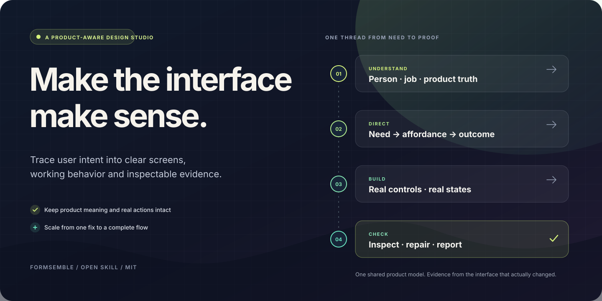

  

  <strong>A portable design skill for AI coding assistants.</strong> 
  Understand the product. Shape the interface. Check what actually changed.

  <a href="LICENSE"><strong>MIT</strong></a>
  &nbsp;·&nbsp; v1.2.0
  &nbsp;·&nbsp; Codex and Claude Code formats
  &nbsp;·&nbsp; Python is optional for the design workflow

Formsemble is for people using an AI coding assistant to change an existing product interface without losing the product's real behavior. It connects product understanding, UX, visual direction, content, implementation, and evidence-based review in one adaptable workflow.

It is a set of reusable instructions and optional local tools—not a UI framework, component library, or claim of automatic design quality.

## Start with one real task

Install the skill, then describe the product and the outcome you need. Formsemble scales its process to the request: a narrow fix should stay narrow; a full journey should be implemented and checked as a full journey.

~~~text
$formsemble Improve the equipment-return flow. First inspect the current user,
domain objects, save behavior, and relevant notes. Preserve the working
integration. Implement the requested flow and its relevant error and empty
states, then report which checks were actually performed.
~~~

Use /formsemble in Claude Code. See [more task prompts](examples/prompts.md), including audit-only, direction-only, and corrected-product cases.

## One thread from need to proof

| Stage | Formsemble asks | Result |
|---|---|---|
| **Understand** | Who is doing what, with which real product objects and constraints? | A compact product model grounded in current source and supplied evidence |
| **Direct** | What must the screen make clear, and what action must it preserve? | Screen commitments linked to visible controls and outcomes |
| **Build** | What is the smallest representative slice that tests the hard decisions? | The requested interface and its relevant states, using the existing stack |
| **Check** | What can the available tools actually verify? | Rendered inspection, behavior and accessibility checks where possible, and an honest evidence record |

For work likely to continue, a small project-local design note keeps decisions and corrections available to the next session. It does not store project facts in the installed skill.

## What makes the workflow distinct

- **Product truth drives the design.** Current routes, data, actions, permissions, and source behavior inform the interface; a brand name or old mockup is not treated as proof.
- **The process fits the scope.** A patch gets a focused inspection and check. A flow gets the relevant states. A studio-scale request gets discovery, a meaningful direction, implementation, and review.
- **Behavior stays visible.** A visual change does not silently remove routes, integrations, data meaning, or recovery paths.
- **Responsibilities do not become pretend people.** UX, art direction, content, engineering, and quality are coverage areas. Delegate only when an appropriate independent reviewer or tool is actually available.
- **Evidence stays honest.** Source inspection, simulated behavior, exercised interactions, rendered images, and human research are kept separate. Missing tools are reported as untested.
- **Corrections reach dependent decisions.** When the user corrects the premise, revisit the affected hierarchy, content, states, and interactions—not just one label.

These choices are intended to make each deliverable more specific to its product and easier to inspect. They do not establish worldwide novelty, guaranteed originality, measured superiority, or improved conversion.

## Choose the amount of work

| Request | Formsemble's shape | Expected result |
|---|---|---|
| **Patch** | Inspect the affected area, make a bounded fix, check nearby behavior | A focused change with honest verification |
| **Flow** | Refresh product understanding, define screen commitments, implement and review | The requested screen or journey with relevant states |
| **Studio** | Reconstruct the product, explore meaningful directions, implement and extend | A coherent multi-screen or system-level result |
| **Audit only** | Read the relevant implementation and evidence without editing | Prioritized findings with evidence and limits |
| **Direction only** | Propose a visual approach and render it when tools allow | A clearly labeled design proposal, without claims of integration |

## Install

The portable skill is the complete <strong>skills/formsemble/</strong> folder. Keep its MIT license, SKILL.md, references, assets, scripts, and optional agent metadata together. Python 3.9 or newer is needed only for the helper tools.

### Windows

From the extracted release directory, preview the planned user-level install and then install:

~~~powershell
py -3 tools\install_skill.py --host both --scope user --dry-run
py -3 tools\install_skill.py --host both --scope user
~~~

### macOS or Linux

~~~bash
python3 tools/install_skill.py --host both --scope user --dry-run
python3 tools/install_skill.py --host both --scope user
~~~

For project-level installation, use <code>--scope project</code> and provide the absolute path with <code>--project-root</code>. Replace <code>both</code> with <code>codex</code> or <code>claude</code> for one host. The installer copies local files only: it does not change host settings or permissions, and it leaves a different existing installation untouched. Manual copy is also supported. See [INSTALL.md](INSTALL.md) for locations, updates, and the offline Windows folder creator.

| Host | User scope | Project scope | Invocation |
|---|---|---|---|
| Codex CLI / IDE | <code>~/.agents/skills/formsemble/</code> | <code>&lt;project&gt;/.agents/skills/formsemble/</code> | <code>$formsemble</code> |
| Claude Code | <code>~/.claude/skills/formsemble/</code> | <code>&lt;project&gt;/.claude/skills/formsemble/</code> | <code>/formsemble</code> |

Local installation is separate from ChatGPT-managed skills and Claude account or cloud installation. The project was prepared for these documented formats; native execution inside both hosts has not been established by the package tooling tests.

## Verify the release

Run from the release root:

~~~powershell
py -3 -B tools\verify_package.py
py -3 -B -m unittest discover -s tests -v
~~~

On macOS or Linux, use python3 -B with the same script paths. The verifier checks the release inventory and SHA-256 fingerprints. The standard-library test suite exercises the optional evidence checker, local installer, package verifier, and offline Windows bundle generator. Tests do not benchmark model design quality or prove that a documented observation actually occurred.

For a review record created during product work, the optional read-only checker can verify file fingerprints and declared evidence consistency:

~~~bash
python3 skills/formsemble/scripts/check_review.py path/to/review.json --project-root path/to/project
~~~

Exit 0 means the record is valid and its recorded checks are satisfied; 1 means a valid record retains unresolved checks or findings; 2 means the report is malformed, stale, or missing files. A passing record is not a design-quality score or an accessibility certification. See the [quality model](docs/QUALITY.md) and [validation scope](docs/VALIDATION.md).

## Package map

| Path | Purpose |
|---|---|
| [skills/formsemble/LICENSE](skills/formsemble/LICENSE) | MIT terms travel with the installed skill copy |
| [skills/formsemble/SKILL.md](skills/formsemble/SKILL.md) | Portable workflow and routing to the relevant guidance |
| [skills/formsemble/references/](skills/formsemble/references/) | Product model, studio responsibilities, visual direction, implementation, review, memory, and host portability |
| [skills/formsemble/assets/](skills/formsemble/assets/) | Optional project-note and evidence-record templates |
| [skills/formsemble/scripts/check_review.py](skills/formsemble/scripts/check_review.py) | Read-only consistency and file-hash checker for review records |
| [tools/install_skill.py](tools/install_skill.py) | Conservative Codex and Claude Code local installer |
| [tools/build_windows_bundle.py](tools/build_windows_bundle.py) | Offline Windows folder-creator source |
| [tools/verify_package.py](tools/verify_package.py) | Release inventory and fingerprint check |
| [docs/](docs/) and [examples/](examples/) | Quality limits, evaluation protocol, validation notes, and realistic use patterns |

## Limits and sources

Formsemble can only use the files, tools, renderers, browsers, image readers, and independent reviewers available in the active session. It does not create those capabilities, install dependencies for the product, or itself prove that an interface works. Its review checker validates the record's structure, declared paths, hashes, and method/status rules; it cannot inspect image pixels, establish the truth of an observation, judge visual quality, or certify accessibility. A model-based screen reading is a diagnostic perspective, not user research.

No conversion lift, user-research result, guaranteed design quality, global uniqueness, or trademark clearance is claimed. Read [validation scope](docs/VALIDATION.md) for the checks performed and what remains unestablished.

Host discovery guidance was checked against the official [OpenAI skill documentation](https://learn.chatgpt.com/docs/build-skills) and [Claude Code skill documentation](https://code.claude.com/docs/en/skills) on 2026-11-17. Accessibility review guidance links to the [W3C WCAG 2.2 standard](https://www.w3.org/TR/WCAG22/). Formsemble is independently maintained and is not affiliated with or endorsed by OpenAI, Anthropic, or W3C.

## Help keep it useful

Found an unclear step or a reproducible edge case? [Open a focused issue](https://github.com/ufodia/formsemble/issues/new) with the host and version, sanitized task context, reproduction steps, expected and actual behavior, and the checks you performed. A safe before/after artifact helps others reproduce it. Remove private project information before sharing. Contributions should preserve evidence boundaries and avoid invented performance claims.

If you would like to support independent open-source tools, [buy me a coffee](https://www.buymeacoffee.com/ufodia).
